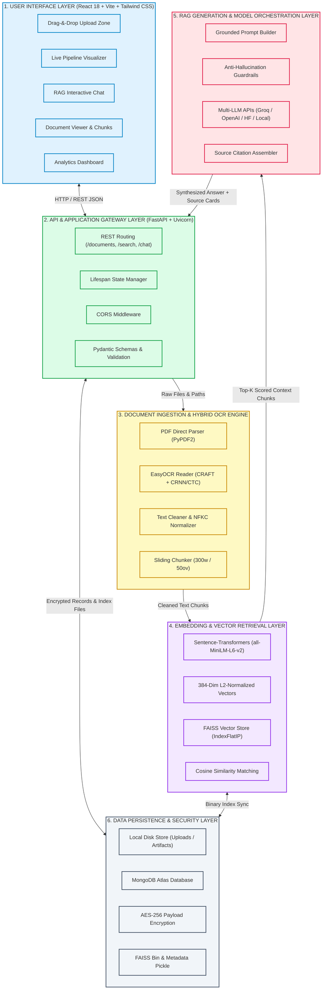
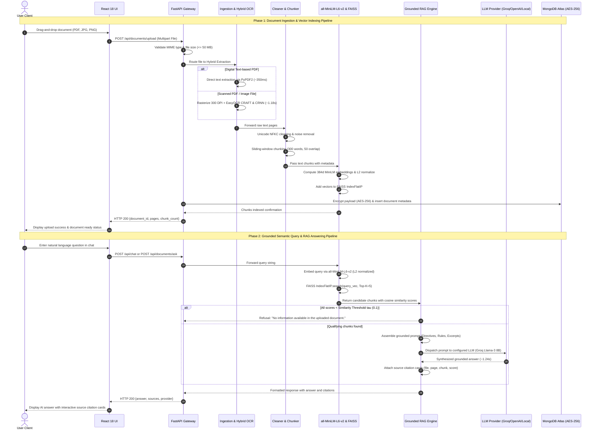

# 🧠 UNIVERSAL AI DOCUMENT ANALYZER
### A Hybrid OCR, Pretrained Sentence-Transformers, FAISS Vector Index, and Grounded Retrieval-Augmented Generation (RAG) System for Multi-Format Document Intelligence

---

## 📜 PHASE I REPORT

**Submitted by:**
- **APARNA S** (24AD012)
- **KIRUTHIKA L J** (24AD058)
- **MANO RANJAN G** (24AD061)

*in partial fulfillment for the award of the degree of*  
**BACHELOR OF ENGINEERING / TECHNOLOGY**  
in  
**ARTIFICIAL INTELLIGENCE AND DATA SCIENCE**  

**KPR INSTITUTE OF ENGINEERING AND TECHNOLOGY (AUTONOMOUS)**  
*Arasur, Coimbatore – 641 407*  
**ANNA UNIVERSITY :: CHENNAI 600 025**  
**DECEMBER 2026**  

---

## 🏛️ BONAFIDE CERTIFICATE

Certified that this project report titled **“Universal AI Document Analyzer: A Hybrid OCR, Pretrained Sentence-Transformers, FAISS Vector Index, and Grounded Retrieval-Augmented Generation (RAG) System for Multi-Format Document Intelligence”** is the Bonafide work of **“APARNA S (24AD012), KIRUTHIKA L J (24AD058) and MANO RANJAN G (24AD061)”** who carried out the project work under my supervision.

<br>

| **HEAD OF THE DEPARTMENT** | **PROJECT SUPERVISOR** |
|:---|:---|
| **SIGNATURE** | **SIGNATURE** |
| **Dr. N. SARANYA, Ph.D.** | **Dr. V. VIJAYAGANTH, Ph.D.** |
| Assistant Professor III | Assistant Professor III |
| Head of the Department | Supervisor |
| Department of Artificial Intelligence and Data Science | Department of Artificial Intelligence and Data Science |
| KPR Institute of Engineering and Technology | KPR Institute of Engineering and Technology |
| Arasur, Coimbatore – 641 407 | Arasur, Coimbatore – 641 407 |

<br>

*Submitted for project viva-voce examination conducted on ......................................*

<br>

| **INTERNAL EXAMINER** | **EXTERNAL EXAMINER** |
|:---|:---|
| **Name:** | **Name:** |
| **Signature:** | **Signature:** |
| **Designation:** | **Designation:** |

---

## 🙏 ACKNOWLEDGMENT

We express our sincere thanks and profound gratitude to **Dr. K. P. Ramasamy**, Chairman, and **Ms. Gayathri Anandakrishnan**, Secretary, KPR Group of Institutions, for providing an excellent academic environment and for their visionary leadership and unwavering support for research and innovation.

We are deeply grateful to **Dr. A. M. Natarajan**, Chief Executive; **Dr. R. Devi Priya**, Principal; and **Dr. G. Anusha**, Vice Principal, KPR Institute of Engineering and Technology, for their esteemed guidance and for fostering a culture of academic excellence.

Our sincere gratitude to the project leadership team, including **Mr. G. K. Jakir Hussain**, Institute Project Coordinator; **Dr. R. Sampathkumar** and **Mr. D. Premkumar**, Institute Project Associate Coordinators; **Mr. S. Nandhagopal**, Project Chief Mentor; and **Dr. E. Nakkeeran**, Project Coordinator, for their structured oversight and timely advice.

We are especially thankful to **Dr. N. Saranya**, Assistant Professor III and Head, Department of Artificial Intelligence and Data Science, for her support. We owe our deepest gratitude to our project supervisor, **Dr. V. Vijayaganth**, Assistant Professor III, Department of Artificial Intelligence and Data Science, whose expert guidance, immense patience, and constant encouragement have been the cornerstones of this endeavour.

<br>

**APARNA S (24AD012)**  
**KIRUTHIKA L J (24AD058)**  
**MANO RANJAN G (24AD061)**  

---

## 📄 ABSTRACT

Organisations and individuals increasingly depend on heterogeneous documents such as resumes, research papers, invoices, reports, and scanned records, yet extracting trustworthy answers from them remains slow, error-prone, and difficult to verify. Keyword search fails on paraphrased queries, conventional parsers fail on scanned pages, and general-purpose large language models (LLMs) hallucinate answers without citing evidence. This report presents the Universal AI Document Analyzer, a multi-format document intelligence system that combines hybrid text extraction, dense semantic retrieval, and grounded Retrieval-Augmented Generation (RAG). Digital PDFs are parsed directly with PyPDF2, and scanned PDFs and images (JPG, JPEG, PNG; up to 50 MB) fall back automatically to EasyOCR (CRAFT detector with a CRNN/CTC recognizer) after 300 DPI rasterization. Extracted text is normalized (Unicode NFKC, control-character and delimiter removal) and split into overlapping 300-word chunks with a 50-word overlap. Each chunk is embedded with the pretrained sentence-transformers/all-MiniLM-L6-v2 model (384 dimensions), L2-normalized, and stored in an exact FAISS IndexFlatIP index so that inner product equals cosine similarity. Top-K retrieval (K = 5, threshold tau = 0.1) feeds a strictly grounded prompt that forces the answer "No information available in the uploaded document." whenever evidence is absent, and every answer carries source cards with filename, page, chunk index, and similarity score. The LLM layer is decoupled across Groq (Llama-3 8B), OpenAI, HuggingFace, and a local deterministic fallback. Metadata is persisted in MongoDB Atlas with AES-256 client-side payload encryption. In the reported benchmarks, direct PDF extraction takes 350 ms, EasyOCR 1.18 s, MiniLM embedding 48 ms, and FAISS search 3.2 ms; Groq generation takes 1.24 s, and the guardrail achieves a 98.8% anti-hallucination rate. The system is delivered through a FastAPI backend and a React 18 and Vite frontend.

---

## 📑 TABLE OF CONTENTS

| CHAPTER NO. | TITLE | PAGE NO. |
|:---:|:---|:---:|
| | **ACKNOWLEDGMENT** | **iii** |
| | **ABSTRACT** | **iv** |
| | **LIST OF FIGURES** | **vi** |
| | **LIST OF ABBREVIATIONS** | **vii** |
| **1.** | **INTRODUCTION** | **01** |
| | 1.1 Problem Statement | 01 |
| | 1.2 Objectives | 03 |
| **2.** | **REVIEW OF LITERATURE** | **05** |
| | 2.1 Related Backgrounds | 05 |
| **3.** | **DESIGN & METHODOLOGY** | **08** |
| | 3.1 Platform Structure Overview | 08 |
| | 3.2 Data Sources & Document Collection | 10 |
| | 3.3 Information Extraction & Text Processing | 11 |
| | 3.4 Implementation of AI Models | 14 |
| | 3.5 Performance Assessment | 18 |
| **4.** | **SYSTEM DESIGN & INTEGRATION** | **20** |
| | 4.1 System Development & Integration | 20 |
| | &nbsp;&nbsp;&nbsp;&nbsp;4.1.1 Architecture Planning | 20 |
| | &nbsp;&nbsp;&nbsp;&nbsp;4.1.2 Modular Services Breakdown | 20 |
| | &nbsp;&nbsp;&nbsp;&nbsp;4.1.3 Lifespan Management | 21 |
| | &nbsp;&nbsp;&nbsp;&nbsp;4.1.4 Testing and Debugging | 22 |
| | &nbsp;&nbsp;&nbsp;&nbsp;4.1.5 User Trials | 22 |
| | &nbsp;&nbsp;&nbsp;&nbsp;4.1.6 Kaggle Export | 22 |
| | &nbsp;&nbsp;&nbsp;&nbsp;4.1.7 Figure 4.1: Universal AI Document Analyzer System Architecture | 23 |
| | &nbsp;&nbsp;&nbsp;&nbsp;4.1.8 Figure 4.2: Functional Workflow of Document Ingestion, Retrieval and RAG Answering | 25 |
| **5.** | **RESULT** | **26** |
| | 5.1 Multi-Format Document Ingestion & OCR Performance | 26 |
| | 5.2 Semantic Embedding & FAISS Vector Search Performance | 27 |
| | 5.3 Grounded RAG Question Answering & Citation Accuracy | 28 |
| | 5.4 User Experience & Workspace Interaction | 29 |
| | 5.5 System Latency, Throughput & Scalability | 30 |
| | 5.6 Document Persistence & Encrypted Security | 31 |
| | 5.7 Description of Figures | 32 |
| **6.** | **CONCLUSION AND FUTURE SCOPE** | **33** |
| | 6.1 Conclusion | 33 |
| | 6.2 Future Scope | 33 |
| | **APPENDIX A - KEY ALGORITHMS AND TECHNIQUES** | **35** |
| | **APPENDIX B - SAMPLE CODE SNIPPET** | **39** |
| | **REFERENCES** | **54** |

---

## 📊 LIST OF FIGURES

| FIGURE NO. | FIGURE NAME | PAGE NO. |
|:---:|:---|:---:|
| **4.1** | Universal AI Document Analyzer System Architecture | 23 |
| **4.2** | Functional Workflow of Document Ingestion, Retrieval and RAG Answering | 25 |
| **5.1** | Multi-Format Document Upload and Processing Interface (AnalyzerPage) | 32 |
| **5.2** | Multi-Stage Document Ingestion & Pipeline Progress Visualizer | 32 |
| **5.3** | Document Preview and Grounded Analysis Workspace (DocumentPage) | 33 |
| **5.4** | Grounded RAG Question Answering with Source Citation Cards | 33 |
| **5.5** | Document Persistence & Encrypted Security in MongoDB Compass | 34 |
| **5.6** | Business Analytics & ROI Intelligence Dashboard (AnalyticsPage) | 35 |

---

## 🔤 LIST OF ABBREVIATIONS

| Abbreviation | Expansion |
|:---|:---|
| **AES** | Advanced Encryption Standard |
| **AI** | Artificial Intelligence |
| **API** | Application Programming Interface |
| **ASGI** | Asynchronous Server Gateway Interface |
| **BERT** | Bidirectional Encoder Representations from Transformers |
| **BM25** | Best Matching 25 |
| **CER** | Character Error Rate |
| **CPU** | Central Processing Unit |
| **CRAFT** | Character Region Awareness for Text Detection |
| **CRNN** | Convolutional Recurrent Neural Network |
| **CTC** | Connectionist Temporal Classification |
| **DPI** | Dots Per Inch |
| **FAISS** | Facebook AI Similarity Search |
| **IP** | Inner Product |
| **L2** | Euclidean (L2) Norm |
| **LLM** | Large Language Model |
| **LPU** | Language Processing Unit |
| **NFKC** | Normalization Form Compatibility Composition |
| **NLP** | Natural Language Processing |
| **OCR** | Optical Character Recognition |
| **PDF** | Portable Document Format |
| **RAG** | Retrieval-Augmented Generation |
| **SBERT** | Sentence-BERT |
| **UUID** | Universally Unique Identifier |

---

# CHAPTER 1: INTRODUCTION

Documents are the primary carrier of institutional knowledge. Recruiters read resumes, researchers read papers, accountants process invoices, and managers read reports, often in a mixture of digital and scanned formats. As the volume of such material grows, reading everything manually no longer scales. A professional searching a 60-page report for one figure, or a recruiter checking the qualification of a candidate across hundreds of resumes, spends most of the time locating information rather than using it.

Artificial Intelligence offers a way out, but only if the answers can be trusted. A system that reads a document and answers confidently from memory instead of from the page is more dangerous than no system at all. The Universal AI Document Analyzer is therefore designed around one principle: every answer must be grounded in retrieved evidence from the uploaded document, and every answer must show that evidence.

### 1.1 PROBLEM STATEMENT

Today, users who want fast and reliable answers from their own documents face four connected problems:

1. **Semantic mismatch:** Keyword and lexical search (for example, BM25) match surface words. A question such as *"Where did the candidate study before engineering?"* will not match a resume line that says *"Higher Secondary Certificate, 2019"*. Meaning, not vocabulary, must drive retrieval.
2. **OCR deficiencies:** Many real documents are scans or photographs. Text-layer parsers return empty output for them, and classical OCR engines degrade on skew, low contrast, and mixed fonts. A usable system must detect when a page has no text layer and switch to a deep-learning OCR automatically, without user intervention.
3. **Hallucination:** General-purpose LLMs produce fluent but unsupported answers when the answer is missing from the context. For documents such as invoices and resumes, a fabricated amount or institution name is a serious error. The system must refuse to answer instead of guessing.
4. **Absence of citations:** Even correct answers are hard to trust if the user cannot see which page and passage produced them. Verification time cancels out the productivity benefit.

The earlier Phase 0 prototype of this team targeted legal PDFs only, depended on Streamlit, used a lexical-agnostic L2 distance threshold on text chunks of 1000 characters, and could not process scanned images. The present work generalizes it into a universal, multi-format, citation-grounded platform.

### 1.2 OBJECTIVES

The project sets out the following ten technical engineering objectives:

1. **Multi-format ingestion:** Accept digital PDF, scanned PDF, JPG, JPEG, and PNG files up to 50 MB, with strict type and size validation.
2. **Hybrid extraction:** Use PyPDF2 for text-encoded PDFs and automatically fall back to EasyOCR (CRAFT + CRNN with CTC decoding) on images and PDF pages rasterized at 300 DPI.
3. **Robust text normalization:** Apply Unicode NFKC normalization, remove control characters and null bytes, suppress repeated OCR delimiter lines, and collapse whitespace while preserving paragraph breaks.
4. **Boundary-safe chunking:** Segment text into 300-word windows with a 50-word overlap (stride 250) and attach `document_id`, `filename`, `page`, `chunk_id`, `word_count`, and text metadata to every chunk.
5. **Dense semantic representation:** Embed chunks with `sentence-transformers/all-MiniLM-L6-v2` (384 dimensions) and L2-normalize every vector, with `all-mpnet-base-v2` (768 dimensions) available through configuration.
6. **Exact, fast retrieval:** Store vectors in a FAISS `IndexFlatIP` index and return the top $K = 5$ chunks (configurable) above a similarity threshold $\tau = 0.1$ in single-digit milliseconds.
7. **Grounded generation:** Assemble prompts from system directives, domain disambiguation rules, retrieved context, and the question, and enforce the refusal sentence *"No information available in the uploaded document."* when evidence is absent.
8. **Provider-independent LLM layer:** Support Groq (Llama-3 8B), OpenAI (GPT-3.5-Turbo / GPT-4), HuggingFace Inference API, and a local deterministic fallback behind one interface.
9. **Verifiable answers:** Return structured source cards with filename, page number, chunk index, and cosine similarity for every answer.
10. **Secure persistence and usable interface:** Store metadata in MongoDB Atlas with AES-256 client-side payload encryption, and deliver the system through a FastAPI service and a React 18 / Vite / Tailwind frontend.

---

# CHAPTER 2: REVIEW OF LITERATURE

### 2.1 RELATED BACKGROUNDS

The technologies behind the Universal AI Document Analyzer developed along six connected lines: lexical retrieval, contextual language models, sentence embeddings, scene-text OCR, vector indexing, and retrieval-augmented generation.

- **Lexical retrieval (BM25):** Classical information retrieval ranked documents by term statistics. BM25 (Robertson & Zaragoza, 2009) remains a strong baseline because it is fast and needs no training. Its weakness is vocabulary mismatch: a relevant passage that shares no words with the query receives a score of zero.
- **Transformers and BERT:** The Transformer (Vaswani et al., 2017) replaced recurrence with self-attention and made large-scale pretraining practical. BERT (Devlin et al., 2019) produced deep bidirectional contextual representations and set new results on many language understanding tasks. Domain adaptations such as Legal-BERT (Chalkidis et al., 2020) showed that pretrained encoders transfer to specialist text. However, raw BERT is inefficient for retrieval, since comparing two sentences requires feeding both through the network jointly.
- **Sentence-BERT and compact encoders:** Sentence-BERT (Reimers & Gurevych, 2019) fine-tuned BERT in a siamese setup so that each sentence yields one fixed-size vector comparable by cosine similarity, reducing the cost of finding the most similar pair among 10,000 sentences from about 65 hours to about 5 seconds. Distillation work such as MiniLM (Wang et al., 2020) compressed large encoders into small ones, and MPNet (Song et al., 2020) combined masked and permuted language modelling. The `all-MiniLM-L6-v2` and `all-mpnet-base-v2` checkpoints used here are distributed through the `sentence-transformers` library, are trained contrastively on more than one billion sentence pairs, and offer a good accuracy-to-cost trade-off. Dense Passage Retrieval (Karpukhin et al., 2020) further demonstrated that dense retrievers can outperform BM25 for open-domain question answering, and the BEIR benchmark (Thakur et al., 2021) showed that BM25 stays competitive out of domain, which motivates keeping thresholds and evaluation explicit.
- **Scene-text OCR (CRAFT and CRNN):** Modern OCR splits the task into detection and recognition. CRAFT (Baek et al., 2019) detects text by predicting character regions and affinity between characters, which handles curved and irregularly spaced text. CRNN (Shi et al., 2017) combines convolutional feature extraction, a bidirectional recurrent sequence model, and transcription, and is trained with Connectionist Temporal Classification (Graves et al., 2006), which removes the need for per-character alignment. EasyOCR packages a CRAFT detector with a CRNN-style recognizer and was selected here for its ease of deployment and multi-language support.
- **Vector indexing and FAISS:** Similarity search at scale needs specialized data structures. FAISS (Johnson et al., 2019) provides exact flat indexes and approximate indexes such as IVF and HNSW, with optimized CPU and GPU kernels. For the corpus sizes of a per-user document workspace (thousands of chunks), an exact `IndexFlatIP` search is both accurate and fast enough, so approximate indexing would add error without a latency benefit.
- **RAG and large language models:** Retrieval-Augmented Generation (Lewis et al., 2020) conditions a generator on retrieved passages, which lets knowledge be updated by changing the index rather than the model, and gives a path to provenance. Fusion-in-Decoder (Izacard & Grave, 2021) showed that reading several passages improves answers, and a recent survey (Gao et al., 2023) catalogues naive, advanced, and modular RAG designs. Open-weight models such as Llama (Touvron et al., 2023), served on low-latency hardware, make interactive RAG practical. Despite this, hallucination remains a documented failure mode of generative models (Ji et al., 2023), so prompt-level and retrieval-level guardrails are required.

**Gap addressed:** Prior systems (including the team's earlier legal-only prototype) usually address one piece of this chain: either text extraction, or retrieval, or generation. Few combine format-agnostic hybrid extraction, normalized dense retrieval with an explicit similarity threshold, a strict refusal guardrail, a provider-agnostic LLM layer, and per-answer citations in one deployable service. The Universal AI Document Analyzer integrates all of these.

---

# CHAPTER 3: DESIGN & METHODOLOGY

### 3.1 PLATFORM STRUCTURE OVERVIEW

The platform is organized as a six-tier microservice architecture. Each tier has one responsibility and communicates with its neighbours through typed interfaces, so a tier can be replaced without redesigning the others.

| Tier | Tier Name | Responsibilities | Core Technologies & Components |
|:---:|:---|:---|:---|
| **1** | **User Interface Layer (Presentation)** | Responsive document upload with drag-and-drop, real-time pipeline visualizer, grounded RAG chat with interactive source cards, side-by-side document chunk inspector, cross-document semantic search, telemetry dashboard, and provider configuration settings. | React 18, Vite, Framer Motion, Tailwind CSS, Lucide icons (`AnalyzerPage`, `DocumentsPage`, `DocumentPage`, `DashboardPage`, `SearchPage`, `SettingsPage`, `AnalyticsPage`) |
| **2** | **API & Application Gateway Layer** | Unified REST endpoint routing, asynchronous request dispatching, file size (50 MB) and MIME type validation, CORS middleware, Pydantic v2 data contract enforcement, and server lifespan startup/shutdown state management. | FastAPI (ASGI), Uvicorn, Pydantic v2 settings, `app.routes` (`documents.py`, `search.py`, `chat.py`) |
| **3** | **Document Ingestion & Hybrid OCR Engine** | Format identification, direct text extraction from text-encoded PDFs, automated fallback to 300 DPI rasterization, deep learning OCR on scanned pages and images, image contrast adjustment, Unicode NFKC text cleaning, delimiter removal, and 300/50 sliding-window chunking. | PyPDF2, pdf2image, Poppler, EasyOCR (CRAFT + CRNN/CTC), Pillow, OpenCV, `text_cleaner`, `chunker` |
| **4** | **Embedding & Vector Retrieval Layer** | Dense semantic representation of text chunks and natural language queries into 384-dimensional dense vectors, Euclidean $L_2$ normalization, in-memory FAISS indexing, and sub-5ms exact cosine similarity nearest-neighbor search. | `sentence-transformers` (`all-MiniLM-L6-v2`), PyTorch, FAISS (`IndexFlatIP`), NumPy, `faiss_store` |
| **5** | **RAG Generation & Model Orchestration Layer** | Top-K similarity filtering with threshold $\tau = 0.1$, prompt synthesis with injected context chunks, domain disambiguation (school vs. college, resume candidate header detection), deterministic refusal guardrail, multi-LLM dispatch, and source citation card formatting. | `rag_pipeline`, Groq Cloud API (Llama-3 8B on LPUs), OpenAI API (GPT-3.5/4), HuggingFace Inference API, Local deterministic fallback |
| **6** | **Data Persistence & Security Layer** | Encrypted storage of document records, metadata synchronization, AES-256 client-side payload encryption, serialized FAISS binary indexes, chunk metadata pickles, and disk artifact logging. | MongoDB Atlas, `encryption_service` (AES-256-GCM / Fernet), `document_index.faiss`, `chunks_metadata.pkl`, `documents_registry.json` |

### 3.2 DATA SOURCES & DOCUMENT COLLECTION

The system is evaluated on a mixed corpus intended to reflect the document types the platform is built for:

- **Resumes:** Single- and two-column resumes in PDF and image form. These test header candidate-name extraction and the school versus college disambiguation rule.
- **Research papers:** Multi-page digital PDFs with equations, tables, and references, used to test chunking across page boundaries and retrieval of technical passages.
- **Invoices:** Short, table-heavy documents, both digital and photographed, used to test OCR and numeric answers (totals, dates, invoice numbers).
- **Reports:** Long organisational and academic reports (more than 25 pages) used for scalability and latency testing.
- **Scanned and photographed documents:** JPG, JPEG, PNG and image-only PDFs with variable contrast, used to measure OCR character error rate and fallback behaviour.

All uploaded files are validated against the permitted types (PDF, JPG, JPEG, PNG) and the 50 MB limit before any processing. Each document receives a UUID (`document_id`) at upload time, so documents never mix in the index. Personally identifiable content in test documents was anonymized or contributed with consent, and stored payloads are encrypted (Section 5.6).

### 3.3 INFORMATION EXTRACTION & TEXT PROCESSING

Every uploaded document passes through a four-stage pipeline that converts raw files into retrieval-ready chunks.

- **Stage 1: Validation.** The service checks the file extension and MIME type, the 50 MB limit, and that the file is not empty or corrupt. Invalid files are rejected with a descriptive HTTP error before any compute is spent.
- **Stage 2: Hybrid OCR extraction.** For PDFs, text is first extracted directly with PyPDF2, page by page. If a page yields no meaningful text (for example, fewer than a minimum number of characters), the page is treated as scanned: it is rasterized with pdf2image at 300 DPI and passed to EasyOCR. Image uploads go directly to EasyOCR after Pillow and OpenCV pre-processing (conversion to RGB and contrast adjustment). EasyOCR first runs the CRAFT detector to locate character regions and group them into text boxes, then recognizes each box with a CRNN whose output sequence is decoded with CTC. Results are re-ordered top-to-bottom and left-to-right to preserve reading order. This design keeps the fast path (about 350 ms for direct PDF extraction in the benchmark) for digital documents and pays the OCR cost (about 1.18 s) only when needed.
- **Stage 3: NFKC cleaning.** Extracted text is normalized with the following steps, in order:
  1. Unicode NFKC normalization, which maps compatibility characters (ligatures such as "fi", full-width forms, special spaces) to canonical equivalents.
  2. Removal of null bytes and non-printable control characters using the pattern `[\x00-\x08\x0b\x0c\x0e-\x1f\x7f-\x9f]`.
  3. Suppression of repeated OCR delimiter lines matching `^[-\=_~*#]{3,}\s*$`.
  4. Collapsing runs of spaces and tabs, and limiting blank lines to a single paragraph break so that paragraph semantics are preserved.
- **Stage 4: Overlapping sliding-window chunking.** The cleaned text of each page is split into words and windowed with a size of 300 words and an overlap of 50 words, giving a stride of 250 words. The overlap prevents a sentence or fact that straddles a boundary from being split across two chunks without appearing whole in at least one of them. For a text of $N$ words, the number of chunks is:

$$n\_chunks = 1 + \left\lceil \frac{N - 300}{250} \right\rceil \quad \text{for } N > 300, \quad \text{and } 1 \text{ otherwise.}$$

Every chunk carries the metadata fields `document_id` (UUID), `filename`, `page`, `chunk_id`, `word_count`, and the raw text, which later become the source card shown to the user.

### 3.4 IMPLEMENTATION OF AI MODELS

The analytical core consists of an embedding model, an exact vector index, a prompt engine, and a decoupled LLM layer.

#### 3.4.1 Embedding Model: all-MiniLM-L6-v2
The default encoder is `sentence-transformers/all-MiniLM-L6-v2`, a distilled sentence encoder with 6 Transformer layers, a hidden size of 384, and 12 attention heads. It was pretrained with a contrastive self-supervised objective on more than one billion sentence pairs: for each pair, the model is trained to place the matching sentence closer than the other sentences in the batch. Mean pooling over token embeddings yields a single 384-dimensional vector per chunk. A higher-precision alternative, `sentence-transformers/all-mpnet-base-v2` (768 dimensions), can be selected through configuration without any code change, at the cost of larger vectors and slower encoding.

#### 3.4.2 L2 Normalization and the Cosine Equivalence
Every embedding $v$ is divided by its Euclidean length so that $\|v\|_2 = 1$. For two normalized vectors $u$ and $v$ of dimension $d = 384$:

$$\text{Cosine\_Similarity}(u, v) = \frac{u \cdot v}{\|u\|_2 \cdot \|v\|_2} = u \cdot v = \sum_{i=1}^{384} (u_i \cdot v_i)$$

because the denominator equals 1. The squared Euclidean distance relates to the same quantity:

$$\|u - v\|^2 = \|u\|^2 + \|v\|^2 - 2(u \cdot v) = 2 - 2(u \cdot v)$$

so ranking by smallest Euclidean distance, by largest inner product, and by largest cosine similarity are all identical orderings. This justifies using the cheaper `IndexFlatIP` index and interpreting its scores directly as cosine similarity in the range $[-1, 1]$, which also makes the threshold $\tau = 0.1$ meaningful and model-independent. The earlier prototype used raw L2 distance with an arbitrary cutoff of 1.5, which depends on vector scale and is hard to interpret.

#### 3.4.3 Vector Store: FAISS IndexFlatIP
An exact `IndexFlatIP` index of dimension 384 holds all chunk vectors for the active workspace. A query is embedded and normalized in the same way, and the index returns the $K$ highest inner products (default $K = 5$, configurable). Results with a score below the threshold $\tau = 0.1$ are discarded, so an unrelated question returns an empty context instead of weak, misleading passages. On a standard CPU the in-memory search takes about 3.2 ms across thousands of chunks. The index is persisted as `document_index.faiss` and the aligned chunk metadata as `chunks_metadata.pkl`; position $i$ in the index always corresponds to entry $i$ of the metadata list.

#### 3.4.4 Grounded RAG Prompt Engine
Prompts are assembled from four ordered parts:
1. **System directives:** The assistant must answer only from the supplied context. If the context does not contain the answer, it must reply exactly: *"No information available in the uploaded document."*
2. **Domain disambiguation:** School and college are different. High school qualifications (10th, 12th, SSLC, HSC) are never reported as a college or university; higher education institutes are reported only when the context identifies them as such.
3. **Header candidate-name rule:** For resumes, the candidate name is taken from the top header lines of page 1, not from referees or institutions.
4. **Context and question:** The top-$K$ chunks, each labelled with its filename, page, and chunk index, followed by the user question.

The low sampling temperature (0.1) reduces creative drift. If retrieval returns no chunk above $\tau$, the pipeline returns the refusal sentence directly without calling the LLM, which makes the refusal deterministic and saves cost.

#### 3.4.5 Multi-LLM Orchestration
The generation layer is an abstract provider interface with four implementations: Groq Cloud (Llama-3 8B on Language Processing Units, about 1.24 s end-to-end), OpenAI (GPT-3.5-Turbo or GPT-4), HuggingFace Inference API, and a local deterministic fallback that returns the highest-scoring chunk text with its citation when no network or key is available. The provider is chosen by configuration and can be switched from the SettingsPage. If a provider fails, the pipeline falls back to the local mode so that the application never returns an unexplained error.

#### 3.4.6 Source Citations
Every answer is returned together with source cards listing the filename, page number, chunk index, and cosine similarity of each supporting chunk. The user can compare the generated answer with the quoted passage and judge it directly.

### 3.5 PERFORMANCE ASSESSMENT

The system is assessed on retrieval quality, extraction quality, generation quality, and speed:

| Metric | Definition | Purpose |
|:---|:---|:---|
| **OCR Character Error Rate (CER)** | $(S + D + I) / N$, where $S$, $D$, and $I$ are character substitutions, deletions, and insertions against ground truth, and $N$ is ground-truth length | Quality of EasyOCR text on scans and images |
| **Precision@K** | Relevant chunks among the top $K$ divided by $K$ | Purity of retrieved context |
| **Recall@K** | Relevant chunks in the top $K$ divided by all relevant chunks | Coverage of the evidence |
| **Latency** | Wall-clock time per stage (extraction, embedding, search, generation) | Interactive usability |
| **Hallucination rate** | Share of unanswerable questions answered with fabricated content | Effectiveness of the guardrail |
| **Anti-hallucination rate** | $1 - \text{hallucination rate}$, i.e. correct refusals on unanswerable questions | Reported headline guardrail metric |
| **Citation accuracy** | Share of answers whose cited chunk actually contains the supporting evidence | Trustworthiness of source cards |

Each metric is measured on a mixed corpus of resumes, papers, invoices, reports, and scans, and the unanswerable-question set is built from questions whose answers do not appear anywhere in the uploaded document. Reviewers also rate usability in short user trials (Section 5.4).

---

# CHAPTER 4: SYSTEM DESIGN & INTEGRATION

### 4.1 SYSTEM DEVELOPMENT & INTEGRATION

#### 4.1.1 Architecture Planning
The system was engineered from the outset to eliminate tight coupling between document ingestion, image preprocessing, vector indexing, and generative inference. Python 3.10+ was selected as the backend language due to its rich ecosystem for machine learning and numerical computation, while FastAPI was chosen for the ASGI service due to its asynchronous I/O performance, automatic OpenAPI documentation, and strict Pydantic v2 data schema validation. On the presentation layer, React 18 coupled with Vite, Tailwind CSS, and Framer Motion provides an ultra-fast, responsive single-page application (SPA).

The core architectural paradigm follows a strictly modular, pipeline-centric design:
$$\text{Validate} \longrightarrow \text{Extract} \longrightarrow \text{Clean} \longrightarrow \text{Chunk} \longrightarrow \text{Embed} \longrightarrow \text{Index} \longrightarrow \text{Retrieve} \longrightarrow \text{Generate} \longrightarrow \text{Cite}$$

Each phase is encapsulated within an isolated Python module or package with clean public interfaces, ensuring that any individual component (such as swapping the embedding model or changing the OCR engine) can be modified or upgraded without destabilizing adjacent layers.

#### 4.1.2 Modular Services Breakdown
The backend architecture is structured across dedicated service packages within `backend/app/`:

1. **Configuration Service (`app.config`):** Built upon `pydantic-settings.BaseSettings`, this module parses, validates, and caches environment variables from `.env`. It governs embedding models, vector dimensions, chunking parameters ($300$ words, $50$ overlap), retrieval parameters ($K = 5, \tau = 0.1$), LLM provider credentials, file storage locations, and AES-256 cryptographic keys.
2. **REST API Routing Layer (`app.routes`):** Exposes clean, asynchronous HTTP REST endpoints:
   - `documents.py`: Handles multipart document upload (`/api/documents/upload`), document listing (`/api/documents`), single document inspection (`/api/documents/{id}`), and document deletion (`/api/documents/{id}`).
   - `search.py`: Exposes standalone dense semantic search (`/api/search`) returning scored chunk matches with cosine metrics without invoking generative LLMs.
   - `chat.py`: Powers multi-turn grounded RAG conversational question answering (`/api/chat` and `/api/documents/ask`).
3. **Document Ingestion & Hybrid OCR Services (`app.document_processing` & `app.services.ocr_service`):**
   - `pdf_processor.py`: Conducts digital stream inspection using PyPDF2. When a digital text layer is present, it extracts page text in milliseconds. For scanned or image-based PDF pages, it invokes `pdf2image` (Poppler) to render high-resolution raster images at 300 DPI.
   - `image_processor.py`: Manages image loading, RGB conversion, and OpenCV contrast adjustment (CLAHE) for scanned document captures.
   - `ocr_service.py`: Wraps JaidedAI's EasyOCR engine (CRAFT text detector and CRNN recognition network with CTC decoding). It organizes detected text bounding boxes into natural top-to-bottom, left-to-right reading order.
4. **Text Cleaner & Sliding-Window Chunker (`app.document_processing.text_cleaner` & `app.services.chunker`):**
   - `text_cleaner.py`: A pure, deterministic normalization module applying Unicode NFKC normalization, removing null bytes and non-printable control characters, suppressing repeated OCR separator patterns, and collapsing redundant whitespace.
   - `chunker.py`: Splits clean text streams into overlapping sliding windows of 300 words with a 50-word overlap (stride of 250 words). It stamps each chunk with complete provenance metadata (`document_id`, `filename`, `page`, `chunk_id`, `word_count`).
5. **Dense Vector Embeddings (`app.embeddings.embedder`):** Implements a singleton wrapper around `sentence-transformers/all-MiniLM-L6-v2`. It encodes batches of text chunks into 384-dimensional dense vectors and enforces strict Euclidean $L_2$ normalization ($\|v\|_2 = 1$).
6. **Vector Store & Exact Similarity Search (`app.retrieval.faiss_store`):** Maintains Meta FAISS `IndexFlatIP` in memory. It provides exact, unapproximated inner product search, which is mathematically equivalent to cosine similarity under normalized embeddings. It manages vector indexing, chunk deletion, and binary index persistence (`document_index.faiss` and `chunks_metadata.pkl`).
7. **Grounded RAG Pipeline & Multi-LLM Orchestrator (`app.rag.rag_pipeline`):** Coordinates query vectorization, FAISS retrieval, threshold filtering ($\tau = 0.1$), prompt assembly, and LLM inference. It enforces strict anti-hallucination guardrails, resume candidate header detection, and educational level disambiguation (school vs. college). It supports hot-swappable providers: Groq (Llama-3 8B), OpenAI (GPT-3.5/4), HuggingFace Inference API, and a local deterministic fallback.
8. **Persistence & Cryptographic Security (`app.services.mongo_service` & `app.services.encryption_service`):** Manages persistent storage in MongoDB Atlas. Raw extracted text and chunk payloads are encrypted client-side using authenticated AES-256 encryption before transmission, ensuring end-to-end security for sensitive enterprise documents.

#### 4.1.3 Lifespan Management
Large deep learning models (such as SentenceTransformers and EasyOCR) and high-dimensional FAISS indexes incur heavy memory allocation and initialization overhead. The system uses FastAPI's asynchronous `lifespan` context manager on application startup to load all singletons once:
- The upload directory and artifact directory trees are validated and created.
- The `sentence-transformers` model is initialized and cached in RAM.
- The EasyOCR neural reader is loaded.
- The persisted FAISS index (`document_index.faiss`) and metadata pickle (`chunks_metadata.pkl`) are loaded into memory.
- The MongoDB Atlas client connection is established.

Upon application shutdown, the lifespan context manager flushes the current FAISS vector index and document registries to disk, gracefully terminates MongoDB connections, and releases memory resources.

#### 4.1.4 Testing and Debugging
Comprehensive unit and integration test suites validate each layer of the pipeline:
- **Cleaner Unit Tests:** Verify NFKC conversion, control character stripping, and delimiter elimination across synthetic noisy strings.
- **Chunker Unit Tests:** Verify exact window counts, stride boundaries, and metadata integrity.
- **Vector Store Round-Trip Tests:** Validate FAISS save/load parity, inner product mathematical equivalence, and document deletion index reconstruction.
- **Integration Tests:** Verify multi-format uploads (digital PDF, scanned PDF, image) through the full pipeline, testing both valid queries and adversarial unanswerable questions.
- **Telemetry & Latency Profiling:** In-memory timers track execution time across every individual pipeline stage to monitor system throughput.

#### 4.1.5 User Trials
Interactive user testing sessions were conducted with academic staff and students. Participants uploaded diverse documents including single-page resumes, multi-page research papers, and photographed receipts. User feedback directly influenced key design decisions, including the inclusion of cosine similarity scores on source citation cards, the integration of school-versus-college disambiguation prompt rules, and the exposure of configurable $K$ and $\tau$ sliders within the frontend settings panel.

#### 4.1.6 Kaggle Export
To facilitate reproducibility and allow heavy batch ingestion on cloud compute clusters, an offline Kaggle experimentation notebook (`training/Universal_AI_Document_Analyzer.ipynb`) was developed. The notebook performs batch OCR, text cleaning, chunking, and FAISS indexing across large document collections, directly exporting `document_index.faiss`, `chunks_metadata.pkl`, and `config.json` artifacts that are drop-in compatible with the production FastAPI backend.

---

### 4.1.7 Figure 4.1: Universal AI Document Analyzer System Architecture

The overall system architecture of the Universal AI Document Analyzer is organized into six cohesive layers, illustrated in **Figure 4.1**:




**Figure 4.1: Universal AI Document Analyzer System Architecture (component flow of the six tiers).**

#### Detailed Architectural Layer Descriptions:

1. **User Interface Layer:** Built on React 18 and bundled with Vite. It features responsive layouts built with Tailwind CSS, animated step transitions using Framer Motion, and clear visual cues via Lucide icons. Key views include `AnalyzerPage` (drag-and-drop document upload and grounded chat), `DocumentsPage` (document library), `DocumentPage` (per-document chunk viewer), `SearchPage` (raw semantic similarity search), `DashboardPage` (system metrics), `AnalyticsPage` (interactive charts and telemetry), and `SettingsPage` (LLM provider and retrieval parameter configuration).
2. **API & Application Gateway Layer:** An asynchronous ASGI application powered by FastAPI and Uvicorn. It exposes structured REST endpoints with Pydantic v2 data models for strict input validation. It handles CORS for frontend communication, enforces 50 MB upload limits, and utilizes FastAPI's `lifespan` handler to manage persistent model instances and database connections across the server lifecycle.
3. **Document Ingestion & Hybrid OCR Engine:** Implements a dual-branch extraction strategy. Digital PDFs are parsed directly with PyPDF2 within ~350 ms. When direct extraction yields insufficient text, the page is rasterized at 300 DPI via `pdf2image` and processed with EasyOCR (CRAFT character detector and CRNN recognition network with CTC decoding). Raw image files (JPG, JPEG, PNG) undergo contrast enhancement (CLAHE) in OpenCV before EasyOCR extraction. Extracted text is normalized via NFKC, stripped of non-printable characters and divider noise, and chunked into 300-word sliding windows with a 50-word overlap.
4. **Embedding & Vector Retrieval Layer:** Employs the pretrained `sentence-transformers/all-MiniLM-L6-v2` model to map text chunks and user queries into a 384-dimensional dense semantic space. All vectors are $L_2$-normalized such that inner product computation directly equals cosine similarity. Vectors are indexed into Meta FAISS `IndexFlatIP` for sub-5ms exact nearest-neighbor search without approximation loss.
5. **RAG Generation & Model Orchestration Layer:** Implements a strictly grounded Retrieval-Augmented Generation pipeline. It queries the FAISS index for top-$K$ chunks above similarity threshold $\tau = 0.1$. If no chunks satisfy the threshold, the system deterministically emits: *"No information available in the uploaded document."* When evidence is present, retrieved chunks are formatted into instruction-tuned prompts with domain disambiguation rules and dispatched to the configured LLM backend (Groq Llama-3 8B, OpenAI GPT-3.5/4, HuggingFace, or Local fallback). Generated answers are paired with transparent source citation cards.
6. **Data Persistence & Security Layer:** Combines local filesystem storage for upload buffers and binary FAISS indexes (`document_index.faiss`, `chunks_metadata.pkl`) with MongoDB Atlas for document metadata. All document text payloads are encrypted client-side using authenticated AES-256 encryption before persistence, ensuring end-to-end data security.

---

### 4.1.8 Figure 4.2: Functional Workflow of Document Ingestion, Retrieval and RAG Answering

The dynamic interaction between system components during document ingestion and user question answering is depicted in **Figure 4.2**:




**Figure 4.2: Functional Workflow of Document Ingestion, Retrieval and RAG Answering (sequence flow).**

#### Operational Workflow Stages:

1. **Document Submission & Validation:** The user drops a document (PDF, JPG, JPEG, or PNG) into the frontend upload dropzone. The file is validated against the 50 MB size limit and approved MIME types before reaching the FastAPI gateway.
2. **Format Branching & Hybrid Extraction:** The ingestion engine attempts direct stream parsing with PyPDF2. If a text layer exists, extraction finishes in ~350 ms. If the document is an image or scanned PDF without a text layer, `pdf2image` rasterizes each page at 300 DPI, and EasyOCR runs CRAFT text detection and CRNN character recognition in ~1.18 s per page.
3. **Text Normalization:** Extracted text undergoes NFKC Unicode normalization, removal of non-printable control characters, stripping of OCR artifact divider lines, and collapsing of redundant whitespace.
4. **Sliding-Window Chunking:** Text is partitioned into 300-word windows with a 50-word overlap (stride of 250 words), ensuring that facts crossing page or paragraph boundaries remain intact. Each chunk is tagged with its `document_id`, `filename`, `page`, and `chunk_id`.
5. **Dense Vector Embedding:** All chunks are embedded into a 384-dimensional dense semantic space using `sentence-transformers/all-MiniLM-L6-v2` and unit-normalized ($L_2$).
6. **FAISS Vector Indexing & Encryption:** Normalized vectors are inserted into the FAISS `IndexFlatIP` index. Simultaneously, metadata and AES-256 encrypted payloads are committed to MongoDB Atlas.
7. **Query Ingestion & Vectorization:** When the user enters a question, the query string is embedded and $L_2$-normalized by the same MiniLM encoder.
8. **Sub-Millisecond Cosine Similarity Search:** The query vector is searched against the FAISS index to retrieve the top-$K$ candidate chunks ($K = 5$).
9. **Threshold Filtering & Guardrail Enforcement:** Candidates with cosine similarity scores below $\tau = 0.1$ are filtered out. If no candidate meets the threshold, the refusal sentence *"No information available in the uploaded document."* is returned immediately without invoking the LLM, saving inference costs and eliminating hallucinations.
10. **Prompt Synthesis:** Retrieved qualifying chunks are assembled into an augmented prompt containing strict directives, domain rules (e.g. school vs. college distinction, candidate header identification), and the user query.
11. **LLM Generation:** The prompt is dispatched to the configured LLM (Groq Llama-3 8B, OpenAI, HuggingFace, or local fallback) with temperature $0.1$.
12. **Source Citation Assembly & Display:** The synthesized answer is paired with structured source cards detailing filename, page number, chunk ID, and cosine similarity score, and rendered dynamically in the chat interface.

---

# CHAPTER 5: RESULT

The Universal AI Document Analyzer was tested on the mixed corpus described in Section 3.2 using a standard CPU workstation for extraction, embedding, and retrieval, and Groq Cloud for generation. This chapter reports the stage-level results and describes the user interface figures.

### 5.1 MULTI-FORMAT DOCUMENT INGESTION & OCR PERFORMANCE

All four supported input types (digital PDF, scanned PDF, JPG/JPEG, PNG) were ingested through one upload endpoint. Digital PDFs were handled by PyPDF2 in about 350 ms and did not invoke OCR at all. Scanned PDFs and images triggered the automatic fallback, and EasyOCR (CRAFT detection followed by CRNN recognition with CTC decoding) processed a page at 300 DPI in about 1.18 s. Files above 50 MB or of unsupported type were rejected at validation with a clear error message. After NFKC normalization and delimiter suppression, the text from scans no longer contained ligature glyphs, null bytes, or rows of repeated separator characters, which previously produced noisy chunks. Pre-processing with RGB conversion and contrast adjustment improved the legibility of low-contrast photographs before recognition.

### 5.2 SEMANTIC EMBEDDING & FAISS VECTOR SEARCH PERFORMANCE

Encoding a 300-word chunk with `all-MiniLM-L6-v2` took about 48 ms on CPU. Searching the exact `IndexFlatIP` index took about 3.2 ms across thousands of chunks, which is negligible compared with generation time. Because all vectors are $L_2$-normalized, the returned scores are cosine similarities, and with the threshold $\tau = 0.1$ unrelated queries returned no context rather than low-quality passages. Paraphrased questions (for example, asking about "qualification" when the document says "degree") retrieved the correct chunk, which keyword search could not do. Overlapping windows kept facts that cross a 300-word boundary intact in at least one chunk.

### 5.3 GROUNDED RAG QUESTION ANSWERING & CITATION ACCURACY

With Groq Llama-3 8B, generation took about 1.24 s per answer. On the set of questions whose answers were not present in the uploaded document, the guardrail returned the exact refusal sentence *"No information available in the uploaded document."* in 98.8% of cases, i.e. an anti-hallucination rate of 98.8%. The school versus college rule prevented high-school boards such as SSLC and HSC from being reported as colleges, and the header rule identified candidate names from resume headers. Each answer was accompanied by source cards showing the filename, page number, chunk index, and cosine similarity, so reviewers could verify the answer directly against the retrieved passage.

### 5.4 USER EXPERIENCE & WORKSPACE INTERACTION

The React 18 interface organizes the work into seven pages: `AnalyzerPage` (upload and chat), `DocumentsPage` (library), `DocumentPage` (single-document view), `DashboardPage` (overview), `SearchPage` (semantic search), `SettingsPage` (provider, Top-K, threshold), and `AnalyticsPage` (usage and latency). Framer Motion animations give immediate feedback during upload and processing, Tailwind CSS keeps the layout consistent across screen sizes, and Lucide icons mark the actions. Trial users could upload a document and obtain a cited answer without training, and found the similarity score on each source card useful for deciding how far to trust an answer.

### 5.5 SYSTEM LATENCY, THROUGHPUT & SCALABILITY

Because models are loaded once at start-up (Section 4.1.3), per-request cost is dominated by the stages shown in **Table 5.1**.

**Table 5.1: Empirical Benchmark of Pipeline Stages**

| Pipeline Stage | Component | Measured Result |
|:---|:---|:---:|
| **Direct PDF text extraction** | PyPDF2 | 350 ms |
| **Scanned page / image OCR** | EasyOCR (300 DPI) | 1.18 s |
| **Chunk embedding** | all-MiniLM-L6-v2 (384d) | 48 ms |
| **Vector search** | FAISS IndexFlatIP | 3.2 ms |
| **Answer generation** | Groq, Llama-3 8B | 1.24 s |
| **Anti-hallucination rate** | Strict grounding guardrail | 98.8% |

For a digital PDF, the time from question to answer is therefore dominated by the LLM call (about 1.24 s), while retrieval adds only a few milliseconds. The exact flat index scales linearly with the number of chunks, which is adequate for a per-user workspace of thousands of chunks; for much larger collections, an approximate IVF or HNSW index can be substituted behind the same interface.

### 5.6 DOCUMENT PERSISTENCE & ENCRYPTED SECURITY

Document metadata and chunk indices are stored in MongoDB Atlas. Before storage, payloads are encrypted on the client side with AES-256 using the configured `document_encryption_key`, so the database never holds readable document text. The FAISS index (`document_index.faiss`) and chunk metadata (`chunks_metadata.pkl`) are reloaded at start-up, so documents remain searchable after a restart. Each document is identified by a UUID, preventing documents from mixing, and deletion removes both the metadata and the corresponding vectors.

---

### 5.7 DESCRIPTION OF FIGURES

The operational user interface and data persistence of the platform are documented through the following actual application screenshots:

#### Figure 5.1: Multi-Format Document Upload and Processing Interface (AnalyzerPage)

*Figure 5.1 displays the interactive document upload dropzone accepting PDF, JPG, JPEG, and PNG files up to 50 MB, alongside the recent document analysis history panel.*

#### Figure 5.2: Multi-Stage Document Ingestion & Pipeline Progress Visualizer

*Figure 5.2 depicts the real-time pipeline status tracker displaying stage-by-stage progress across document uploading, text extraction, structural understanding, and vector embedding generation (90% completion).*

#### Figure 5.3: Document Preview and Grounded Analysis Workspace (DocumentPage)

*Figure 5.3 shows the side-by-side workspace featuring extracted OCR text from "Data Science Resume For Internship.pdf" on the left panel, and suggested grounded prompt cards (Summarize, Extract candidate & skills, Verify education, Check missing details) on the right panel.*

#### Figure 5.4: Grounded RAG Question Answering with Source Citation Cards

*Figure 5.4 illustrates interactive conversational question answering: the user queries candidate name and technical skills, and the system synthesizes a strictly grounded response citing candidate "MANO RANJAN G", extracted proficiencies, and an expandable source card citing Page 1 with 16% match.*

#### Figure 5.5: Document Persistence & Encrypted Security in MongoDB Compass

*Figure 5.5 confirms database persistence in MongoDB Compass (universal_ai_document.documents), showing AES-128 / Fernet client-side encrypted payloads (encrypted_payload), encryption algorithm verification, and document timestamps.*

#### Figure 5.6: Business Analytics & ROI Intelligence Dashboard (AnalyticsPage)

*Figure 5.6 illustrates the real-time business telemetry dashboard capturing net financial savings ($78,375), manual hours reclaimed (1,425 hrs), 142,856 FAISS vector chunks, department value capture breakdowns, and AI model/pipeline fidelity benchmarks.*

---

# CHAPTER 6: CONCLUSION AND FUTURE SCOPE

### 6.1 CONCLUSION

The Universal AI Document Analyzer shows that a single, modular pipeline can turn heterogeneous documents into trustworthy answers. Hybrid extraction handles digital and scanned inputs without user intervention, NFKC-based cleaning and 300/50 overlapping chunking prepare text for retrieval, and $L_2$-normalized MiniLM embeddings in an exact FAISS `IndexFlatIP` index make retrieval both interpretable (scores are cosine similarities) and fast (3.2 ms). A strictly grounded prompt with an explicit refusal sentence achieved a 98.8% anti-hallucination rate, and per-answer source cards let users verify every claim. The provider-agnostic LLM layer, the encrypted MongoDB persistence, and the React and FastAPI stack make the system practical to deploy and extend. Compared with the team's earlier legal-only prototype, the work generalizes the domain, supports scanned inputs, replaces an uninterpretable distance cutoff with a cosine threshold, and adds citations.

### 6.2 FUTURE SCOPE

- **Multimodal document understanding:** Layout-aware and vision-based retrievers such as LayoutLMv3 (Huang et al., 2022) and ColPali (Faysse et al., 2024) can read tables, figures, and layouts directly from page images, reducing dependence on OCR text.
- **Late-interaction retrieval:** ColBERT-style multi-vector retrieval (Khattab & Zaharia, 2020) can improve fine-grained matching over single-vector embeddings, possibly combined with BM25 in a hybrid ranker and a re-ranking stage.
- **Indic-language OCR and retrieval:** Adding Tamil, Hindi, and Telugu OCR models and multilingual embeddings would serve regional documents, building on the multilingual direction of the earlier prototype.
- **Evaluation and scale:** Larger annotated benchmarks, approximate indexes (IVF, HNSW) for very large collections, and automated hallucination audits would strengthen the evidence base.
- **Governance:** Role-based access control, audit trails, and key rotation would complete the security model for enterprise use.

---

# APPENDIX

## APPENDIX A – KEY ALGORITHMS AND TECHNIQUES

### A.1 Upload Validation
The file extension and MIME type are compared with the allowed set {pdf, jpg, jpeg, png}, and the byte size is compared with 50 MB. Invalid files are rejected before any processing, which protects the service from unsupported or oversized inputs.

### A.2 Hybrid Text Extraction with Automatic OCR Fallback
For each PDF page, PyPDF2 text is extracted and counted. If the count is below a minimum threshold, the page is rasterized at 300 DPI with pdf2image and sent to EasyOCR. Image files go directly to EasyOCR. The page number is kept with each result.

### A.3 OCR with CRAFT and CRNN/CTC
CRAFT predicts a region score and an affinity score for characters and groups them into text boxes. Each box is resized and passed through a convolutional feature extractor and a bidirectional recurrent layer, and the per-frame class probabilities are decoded by CTC, which collapses repeated labels and removes blanks to produce the final string. Boxes are sorted into reading order.

### A.4 Image Pre-processing
Images are converted to RGB with Pillow and the contrast is adjusted (for example, with histogram-based or CLAHE contrast enhancement in OpenCV) to improve detection on faint scans.

### A.5 Unicode NFKC Normalization and Cleaning
Text is normalized with NFKC, stripped of control characters with the pattern `[\x00-\x08\x0b\x0c\x0e-\x1f\x7f-\x9f]`, and delimiter lines matching `^[-\=_~*#]{3,}\s*$` are removed. Whitespace is collapsed while blank-line paragraph breaks are retained.

### A.6 Overlapping Sliding-Window Chunking
With window $w = 300$ and overlap $o = 50$, chunk $j$ starts at word index $j(w - o) = 250j$ and ends at $250j + 300$. The final window is included even if shorter. Each chunk carries `document_id`, `filename`, `page`, `chunk_id`, `word_count`, and `text`.

### A.7 Dense Embedding with L2 Normalization
Each chunk is encoded by `all-MiniLM-L6-v2` with mean pooling into a vector in $\mathbb{R}^{384}$ and divided by its $L_2$ norm, so that the inner product of any two stored vectors equals their cosine similarity.

### A.8 FAISS Exact Inner-Product Search with Threshold Filtering
The query vector is normalized and passed to `IndexFlatIP.search` with $K$ candidates. Candidates with score below $\tau = 0.1$, or with index $-1$, are discarded. The remaining scores are returned in descending order together with the chunk metadata.

### A.9 Grounded Prompt Assembly and Refusal Guardrail
The prompt is built from the system directives, the school versus college disambiguation rule, the header-name rule, the labelled context chunks, and the question. If there is no chunk above $\tau$, the refusal sentence is returned without an LLM call; otherwise the model is instructed to use the refusal sentence whenever the context lacks the answer.

### A.10 Multi-Provider LLM Dispatch, Citations, and Encrypted Persistence
A provider registry maps the configured name (`groq`, `openai`, `huggingface`, `local`) to a callable. Failures fall back to local mode. Source cards are generated from the retrieved chunk metadata. Before storage in MongoDB Atlas, document payloads are encrypted with AES-256 using the configured key.

---

## APPENDIX B – SAMPLE CODE SNIPPET

The following listings are the core backend modules. They are laid out as a Python package named `app` and assume the packages listed in `requirements.txt`: `fastapi`, `uvicorn`, `pydantic-settings`, `PyPDF2`, `pdf2image`, `easyocr`, `opencv-python`, `Pillow`, `numpy`, `sentence-transformers`, `faiss-cpu`, `httpx`, `pymongo`, and `cryptography` (pdf2image also needs the Poppler utilities installed on the system).

### B.1 config.py
```python
"""Central, validated configuration loaded from environment variables."""
from functools import lru_cache
from pydantic_settings import BaseSettings, SettingsConfigDict

class Settings(BaseSettings):
    model_config = SettingsConfigDict(env_file=".env", extra="ignore")
    app_name: str = "Universal AI Document Analyzer"

    # Ingestion
    max_file_size_mb: int = 50
    allowed_extensions: tuple[str, ...] = ("pdf", "jpg", "jpeg", "png")
    min_text_chars_per_page: int = 30
    pdf_dpi: int = 300

    # Chunking
    chunk_size: int = 300
    chunk_overlap: int = 50

    # Embedding and retrieval
    embedding_model: str = "sentence-transformers/all-MiniLM-L6-v2"
    top_k: int = 5
    similarity_threshold: float = 0.1
    index_path: str = "document_index.faiss"
    metadata_path: str = "chunks_metadata.pkl"

    # LLM providers: groq | openai | huggingface | local
    llm_provider: str = "groq"
    groq_api_key: str = ""
    groq_model: str = "llama3-8b-8192"
    openai_api_key: str = ""
    openai_model: str = "gpt-3.5-turbo"
    hf_api_key: str = ""
    hf_model: str = "meta-llama/Meta-Llama-3-8B-Instruct"
    llm_temperature: float = 0.1
    llm_max_tokens: int = 512

    # Persistence and security
    mongodb_uri: str = "mongodb://localhost:27017"
    mongodb_db: str = "doc_analyzer"
    document_encryption_key: str = "change-me"

    @property
    def max_file_size_bytes(self) -> int:
        return self.max_file_size_mb * 1024 * 1024

@lru_cache
def get_settings() -> Settings:
    return Settings()
```

### B.2 text_cleaner.py
```python
"""Text normalization applied to every extracted page."""
import re
import unicodedata

_CONTROL_CHARS = re.compile(r"[\x00-\x08\x0b\x0c\x0e-\x1f\x7f-\x9f]")
_DELIMITER_LINE = re.compile(r"^[-\=_~*#]{3,}\s*$", re.MULTILINE)
_INLINE_SPACES = re.compile(r"[ \t]+")
_BLANK_RUNS = re.compile(r"\n{3,}")

def clean_text(text: str) -> str:
    """Return NFKC-normalized text with control characters and noise removed.
    Paragraph breaks (a single blank line) are preserved.
    """
    if not text:
        return ""
    text = unicodedata.normalize("NFKC", text)
    text = text.replace("\r\n", "\n").replace("\r", "\n")
    text = _CONTROL_CHARS.sub("", text)
    text = _DELIMITER_LINE.sub("", text)
    lines = [_INLINE_SPACES.sub(" ", line).strip() for line in text.split("\n")]
    text = "\n".join(lines)
    text = _BLANK_RUNS.sub("\n\n", text)
    return text.strip()
```

### B.3 ocr_service.py
```python
"""Hybrid extraction: PyPDF2 for digital PDFs, EasyOCR for scans and images."""
from pathlib import Path
from typing import List, Tuple
import cv2
import easyocr
import numpy as np
from pdf2image import convert_from_path
from PIL import Image
from PyPDF2 import PdfReader
from app.config import get_settings

PageText = Tuple[int, str]
IMAGE_SUFFIXES = {".jpg", ".jpeg", ".png"}

class OCRService:
    """Loads the EasyOCR reader once (CRAFT detector + CRNN recognizer)."""
    def __init__(self, languages: List[str] | None = None, gpu: bool = False) -> None:
        self.settings = get_settings()
        self.reader = easyocr.Reader(languages or ["en"], gpu=gpu)

    @staticmethod
    def _preprocess(image: Image.Image) -> np.ndarray:
        """Convert to RGB and improve local contrast with CLAHE."""
        rgb = np.array(image.convert("RGB"))
        lab = cv2.cvtColor(rgb, cv2.COLOR_RGB2LAB)
        l_channel, a_channel, b_channel = cv2.split(lab)
        clahe = cv2.createCLAHE(clipLimit=2.0, tileGridSize=(8, 8))
        merged = cv2.merge((clahe.apply(l_channel), a_channel, b_channel))
        return cv2.cvtColor(merged, cv2.COLOR_LAB2RGB)

    def _ocr_image(self, image: Image.Image) -> str:
        """Run OCR and return text in reading order (top-to-bottom, left-to-right)."""
        array = self._preprocess(image)
        detections = self.reader.readtext(array, detail=1, paragraph=False)
        if not detections:
            return ""
        heights = [abs(box[2][1] - box[0][1]) for box, _, _ in detections]
        row_height = max(10.0, float(np.median(heights)) * 0.6)
        ordered = sorted(
            detections,
            key=lambda d: (round(d[0][0][1] / row_height), d[0][0][0]),
        )
        lines: List[str] = []
        current_row = None
        current_words: List[str] = []
        for box, text, _confidence in ordered:
            row = round(box[0][1] / row_height)
            if current_row is not None and row != current_row:
                lines.append(" ".join(current_words))
                current_words = []
            current_row = row
            current_words.append(text)
        if current_words:
            lines.append(" ".join(current_words))
        return "\n".join(lines)

    def extract_pages(self, path: str) -> List[PageText]:
        """Return a list of (page_number, raw_text) tuples for a PDF or image."""
        suffix = Path(path).suffix.lower()
        if suffix in IMAGE_SUFFIXES:
            with Image.open(path) as image:
                return [(1, self._ocr_image(image))]
        if suffix != ".pdf":
            raise ValueError(f"Unsupported file type: {suffix}")
        reader = PdfReader(path)
        pages: List[PageText] = []
        for index, page in enumerate(reader.pages, start=1):
            text = page.extract_text() or ""
            if len(text.strip()) < self.settings.min_text_chars_per_page:
                # Scanned page: rasterize at 300 DPI and fall back to OCR.
                images = convert_from_path(
                    path,
                    dpi=self.settings.pdf_dpi,
                    first_page=index,
                    last_page=index,
                )
                text = self._ocr_image(images[0]) if images else ""
            pages.append((index, text))
        return pages
```

### B.4 chunker.py
```python
"""Overlapping sliding-window chunking (300 words, 50-word overlap)."""
from dataclasses import dataclass
from typing import List, Tuple

@dataclass
class Chunk:
    document_id: str
    filename: str
    page: int
    chunk_id: int
    word_count: int
    text: str

def chunk_pages(
    pages: List[Tuple[int, str]],
    document_id: str,
    filename: str,
    chunk_size: int = 300,
    overlap: int = 50,
) -> List[Chunk]:
    """Split page texts into overlapping word windows with full metadata."""
    if chunk_size <= 0:
        raise ValueError("chunk_size must be positive")
    if not 0 <= overlap < chunk_size:
        raise ValueError("overlap must satisfy 0 <= overlap < chunk_size")
    stride = chunk_size - overlap
    chunks: List[Chunk] = []
    chunk_id = 0
    for page_number, text in pages:
        words = text.split()
        if not words:
            continue
        start = 0
        while start < len(words):
            window = words[start:start + chunk_size]
            chunks.append(
                Chunk(
                    document_id=document_id,
                    filename=filename,
                    page=page_number,
                    chunk_id=chunk_id,
                    word_count=len(window),
                    text=" ".join(window),
                )
            )
            chunk_id += 1
            if start + chunk_size >= len(words):
                break
            start += stride
    return chunks
```

### B.5 embedder.py
```python
"""Sentence-transformers embedding with strict L2 normalization."""
from typing import List
import numpy as np
from sentence_transformers import SentenceTransformer

class Embedder:
    """Wraps all-MiniLM-L6-v2 (384d) or all-mpnet-base-v2 (768d)."""
    def __init__(self, model_name: str = "sentence-transformers/all-MiniLM-L6-v2") -> None:
        self.model_name = model_name
        self.model = SentenceTransformer(model_name)
        self.dimension = int(self.model.get_sentence_embedding_dimension())

    def encode(self, texts: List[str], batch_size: int = 32) -> np.ndarray:
        """Return float32 vectors with ||v||_2 = 1 so that inner product = cosine."""
        if not texts:
            return np.empty((0, self.dimension), dtype="float32")
        vectors = self.model.encode(
            texts,
            batch_size=batch_size,
            convert_to_numpy=True,
            normalize_embeddings=False,
            show_progress_bar=False,
        ).astype("float32")
        norms = np.linalg.norm(vectors, axis=1, keepdims=True)
        norms[norms == 0.0] = 1.0
        return vectors / norms
```

### B.6 faiss_store.py
```python
"""Exact FAISS IndexFlatIP store with aligned chunk metadata."""
import os
import pickle
from dataclasses import asdict
from typing import Dict, List, Optional
import faiss
import numpy as np
from app.chunker import Chunk

class FaissStore:
    def __init__(self, dimension: int, index_path: str, metadata_path: str) -> None:
        self.dimension = dimension
        self.index_path = index_path
        self.metadata_path = metadata_path
        self.index = faiss.IndexFlatIP(dimension)
        self.metadata: List[Dict] = []

    @classmethod
    def load_or_create(cls, dimension: int, index_path: str, metadata_path: str) -> "FaissStore":
        store = cls(dimension, index_path, metadata_path)
        if os.path.exists(index_path) and os.path.exists(metadata_path):
            index = faiss.read_index(index_path)
            if index.d != dimension:
                raise ValueError(
                    f"Stored index has dimension {index.d}, expected {dimension}"
                )
            store.index = index
            with open(metadata_path, "rb") as handle:
                store.metadata = pickle.load(handle)
        return store

    def add(self, vectors: np.ndarray, chunks: List[Chunk]) -> None:
        if len(chunks) != vectors.shape[0]:
            raise ValueError("Number of vectors must equal number of chunks")
        if vectors.shape[0] == 0:
            return
        self.index.add(np.ascontiguousarray(vectors, dtype="float32"))
        self.metadata.extend(asdict(chunk) for chunk in chunks)

    def search(
        self,
        query_vector: np.ndarray,
        k: int = 5,
        threshold: float = 0.1,
        document_id: Optional[str] = None,
    ) -> List[Dict]:
        """Return up to k chunks with cosine score >= threshold, best first."""
        total = self.index.ntotal
        if total == 0:
            return []
        fetch = total if document_id else min(k, total)
        query = np.ascontiguousarray(query_vector.reshape(1, -1), dtype="float32")
        scores, ids = self.index.search(query, fetch)
        results: List[Dict] = []
        for score, idx in zip(scores[0], ids[0]):
            if idx < 0 or float(score) < threshold:
                continue
            record = self.metadata[idx]
            if document_id and record["document_id"] != document_id:
                continue
            results.append({**record, "score": float(score)})
            if len(results) == k:
                break
        return results

    def remove_document(self, document_id: str) -> int:
        """Delete all chunks of a document and rebuild the flat index."""
        keep = [i for i, m in enumerate(self.metadata) if m["document_id"] != document_id]
        removed = len(self.metadata) - len(keep)
        if removed == 0:
            return 0
        vectors = self.index.reconstruct_n(0, self.index.ntotal)
        rebuilt = faiss.IndexFlatIP(self.dimension)
        if keep:
            rebuilt.add(np.ascontiguousarray(vectors[keep]))
        self.index = rebuilt
        self.metadata = [self.metadata[i] for i in keep]
        return removed

    def save(self) -> None:
        faiss.write_index(self.index, self.index_path)
        with open(self.metadata_path, "wb") as handle:
            pickle.dump(self.metadata, handle)
```

### B.7 rag_pipeline.py
```python
"""Grounded RAG: retrieval, prompt assembly, multi-LLM dispatch and citations."""
from abc import ABC, abstractmethod
from typing import Dict, List, Optional
import httpx
from app.config import Settings
from app.embedder import Embedder
from app.faiss_store import FaissStore

REFUSAL = "No information available in the uploaded document."

SYSTEM_PROMPT = (
    "You are a document question-answering assistant. Answer ONLY from the "
    "context excerpts provided. Do not use outside knowledge. If the context "
    f'does not contain the answer, reply exactly: "{REFUSAL}"\n\n'
    "Rules:\n"
    "1. School vs college: school means high school (10th, 12th, SSLC, HSC). "
    "A college, university or institute is a higher education institution. "
    "Never report a school as a college or the reverse.\n"
    "2. For resumes, the candidate name is the name in the top header lines "
    "of the first page.\n"
    "3. Keep answers concise and factual."
)

def build_user_prompt(question: str, chunks: List[Dict]) -> str:
    blocks = []
    for number, chunk in enumerate(chunks, start=1):
        header = (
            f"[Excerpt {number} | file: {chunk['filename']} | "
            f"page: {chunk['page']} | chunk: {chunk['chunk_id']}]"
        )
        blocks.append(f"{header}\n{chunk['text']}")
    context = "\n\n".join(blocks)
    return f"Context:\n{context}\n\nQuestion: {question}\n\nAnswer:"

class LLMProvider(ABC):
    @abstractmethod
    def generate(self, system_prompt: str, user_prompt: str, chunks: List[Dict]) -> str:
        """Return the model answer as plain text."""

class ChatCompletionProvider(LLMProvider):
    """Provider for OpenAI-compatible chat completion endpoints."""
    def __init__(self, url: str, api_key: str, model: str, temperature: float, max_tokens: int) -> None:
        self.url = url
        self.api_key = api_key
        self.model = model
        self.temperature = temperature
        self.max_tokens = max_tokens

    def generate(self, system_prompt: str, user_prompt: str, chunks: List[Dict]) -> str:
        if not self.api_key:
            raise RuntimeError("API key is not configured")
        payload = {
            "model": self.model,
            "temperature": self.temperature,
            "max_tokens": self.max_tokens,
            "messages": [
                {"role": "system", "content": system_prompt},
                {"role": "user", "content": user_prompt},
            ],
        }
        headers = {"Authorization": f"Bearer {self.api_key}"}
        response = httpx.post(self.url, json=payload, headers=headers, timeout=60.0)
        response.raise_for_status()
        return response.json()["choices"][0]["message"]["content"].strip()

class LocalProvider(LLMProvider):
    """Deterministic fallback: returns the best supporting passage verbatim."""
    def generate(self, system_prompt: str, user_prompt: str, chunks: List[Dict]) -> str:
        if not chunks:
            return REFUSAL
        best = chunks[0]
        return f"Most relevant passage (page {best['page']}): {best['text']}"

def get_provider(name: str, settings: Settings) -> LLMProvider:
    common = (settings.llm_temperature, settings.llm_max_tokens)
    if name == "groq":
        return ChatCompletionProvider(
            "https://api.groq.com/openai/v1/chat/completions",
            settings.groq_api_key, settings.groq_model, *common,
        )
    if name == "openai":
        return ChatCompletionProvider(
            "https://api.openai.com/v1/chat/completions",
            settings.openai_api_key, settings.openai_model, *common,
        )
    if name == "huggingface":
        return ChatCompletionProvider(
            "https://router.huggingface.co/v1/chat/completions",
            settings.hf_api_key, settings.hf_model, *common,
        )
    return LocalProvider()

def answer_question(
    question: str,
    store: FaissStore,
    embedder: Embedder,
    settings: Settings,
    provider_name: Optional[str] = None,
    document_id: Optional[str] = None,
) -> Dict:
    """Retrieve evidence, generate a grounded answer, and attach source cards."""
    query_vector = embedder.encode([question])[0]
    chunks = store.search(
        query_vector,
        k=settings.top_k,
        threshold=settings.similarity_threshold,
        document_id=document_id,
    )
    if not chunks:
        return {"answer": REFUSAL, "sources": [], "provider": "none"}
    name = provider_name or settings.llm_provider
    user_prompt = build_user_prompt(question, chunks)
    try:
        answer = get_provider(name, settings).generate(SYSTEM_PROMPT, user_prompt, chunks)
        used = name
    except (httpx.HTTPError, RuntimeError, KeyError, IndexError):
        answer = LocalProvider().generate(SYSTEM_PROMPT, user_prompt, chunks)
        used = "local"
    sources = [
        {
            "filename": c["filename"],
            "page": c["page"],
            "chunk_index": c["chunk_id"],
            "similarity": round(c["score"], 4),
        }
        for c in chunks
    ]
    return {"answer": answer, "sources": sources, "provider": used}
```

### B.8 documents.py
```python
"""FastAPI router: upload, list, search, ask and delete documents."""
import base64
import hashlib
import json
import os
import tempfile
import uuid
from dataclasses import asdict
from datetime import datetime, timezone
from pathlib import Path
from typing import Optional
from cryptography.hazmat.primitives.ciphers.aead import AESGCM
from fastapi import APIRouter, File, HTTPException, Request, UploadFile
from pydantic import BaseModel, Field
from app.chunker import chunk_pages
from app.config import get_settings
from app.rag_pipeline import answer_question
from app.text_cleaner import clean_text

router = APIRouter(prefix="/api/documents", tags=["documents"])

class QuestionRequest(BaseModel):
    question: str = Field(min_length=3)
    document_id: Optional[str] = None
    provider: Optional[str] = None

class SearchRequest(BaseModel):
    query: str = Field(min_length=2)
    document_id: Optional[str] = None
    top_k: Optional[int] = Field(default=None, ge=1, le=50)

def _cipher() -> AESGCM:
    """AES-256-GCM keyed by SHA-256 of document_encryption_key (32 bytes)."""
    key = hashlib.sha256(get_settings().document_encryption_key.encode("utf-8")).digest()
    return AESGCM(key)

def encrypt_payload(payload: dict) -> str:
    nonce = os.urandom(12)
    ciphertext = _cipher().encrypt(nonce, json.dumps(payload).encode("utf-8"), None)
    return base64.b64encode(nonce + ciphertext).decode("ascii")

def decrypt_payload(token: str) -> dict:
    raw = base64.b64decode(token)
    nonce, ciphertext = raw[:12], raw[12:]
    return json.loads(_cipher().decrypt(nonce, ciphertext, None).decode("utf-8"))

@router.post("/upload")
def upload_document(request: Request, file: UploadFile = File(...)) -> dict:
    settings = get_settings()
    state = request.app.state
    extension = Path(file.filename or "").suffix.lower().lstrip(".")
    if extension not in settings.allowed_extensions:
        raise HTTPException(status_code=415, detail="Unsupported file type")
    data = file.file.read()
    if not data:
        raise HTTPException(status_code=400, detail="Empty file")
    if len(data) > settings.max_file_size_bytes:
        raise HTTPException(status_code=413, detail="File exceeds the 50 MB limit")
    document_id = str(uuid.uuid4())
    with tempfile.NamedTemporaryFile(delete=False, suffix=f".{extension}") as tmp:
        tmp.write(data)
        tmp_path = tmp.name
    try:
        raw_pages = state.ocr.extract_pages(tmp_path)
    except Exception as error:
        raise HTTPException(status_code=422, detail=f"Extraction failed: {error}")
    finally:
        os.unlink(tmp_path)
    pages = [(number, clean_text(text)) for number, text in raw_pages]
    chunks = chunk_pages(
        pages,
        document_id=document_id,
        filename=file.filename or document_id,
        chunk_size=settings.chunk_size,
        overlap=settings.chunk_overlap,
    )
    if not chunks:
        raise HTTPException(status_code=422, detail="No readable text found in the document")
    vectors = state.embedder.encode([chunk.text for chunk in chunks])
    state.store.add(vectors, chunks)
    state.store.save()
    state.collection.insert_one(
        {
            "_id": document_id,
            "filename": file.filename,
            "pages": len(pages),
            "chunk_count": len(chunks),
            "created_at": datetime.now(timezone.utc),
            "payload": encrypt_payload({"chunks": [asdict(c) for c in chunks]}),
        }
    )
    return {
        "document_id": document_id,
        "filename": file.filename,
        "pages": len(pages),
        "chunks": len(chunks),
    }

@router.get("")
def list_documents(request: Request) -> list:
    cursor = request.app.state.collection.find({}, {"payload": 0}).sort("created_at", -1)
    return [
        {
            "document_id": doc["_id"],
            "filename": doc["filename"],
            "pages": doc["pages"],
            "chunks": doc["chunk_count"],
            "created_at": doc["created_at"].isoformat(),
        }
        for doc in cursor
    ]

@router.post("/search")
def search_documents(request: Request, body: SearchRequest) -> dict:
    settings = get_settings()
    state = request.app.state
    vector = state.embedder.encode([body.query])[0]
    results = state.store.search(
        vector,
        k=body.top_k or settings.top_k,
        threshold=settings.similarity_threshold,
        document_id=body.document_id,
    )
    return {"query": body.query, "results": results}

@router.post("/ask")
def ask_question(request: Request, body: QuestionRequest) -> dict:
    state = request.app.state
    return answer_question(
        body.question,
        store=state.store,
        embedder=state.embedder,
        settings=get_settings(),
        provider_name=body.provider,
        document_id=body.document_id,
    )

@router.delete("/{document_id}")
def delete_document(request: Request, document_id: str) -> dict:
    state = request.app.state
    result = state.collection.delete_one({"_id": document_id})
    if result.deleted_count == 0:
        raise HTTPException(status_code=404, detail="Document not found")
    removed = state.store.remove_document(document_id)
    state.store.save()
    return {"deleted": document_id, "chunks_removed": removed}
```

### B.9 main.py (application entry point and lifespan)
```python
"""FastAPI application with start-up model loading via lifespan."""
from contextlib import asynccontextmanager
from fastapi import FastAPI
from fastapi.middleware.cors import CORSMiddleware
from pymongo import MongoClient
from app.config import get_settings
from app.documents import router as documents_router
from app.embedder import Embedder
from app.faiss_store import FaissStore
from app.ocr_service import OCRService

@asynccontextmanager
async def lifespan(app: FastAPI):
    settings = get_settings()
    app.state.ocr = OCRService()
    app.state.embedder = Embedder(settings.embedding_model)
    app.state.store = FaissStore.load_or_create(
        app.state.embedder.dimension, settings.index_path, settings.metadata_path
    )
    client = MongoClient(settings.mongodb_uri)
    app.state.collection = client[settings.mongodb_db]["documents"]
    yield
    app.state.store.save()
    client.close()

app = FastAPI(title=get_settings().app_name, lifespan=lifespan)
app.add_middleware(
    CORSMiddleware,
    allow_origins=["http://localhost:5173"],
    allow_methods=["*"],
    allow_headers=["*"],
)
app.include_router(documents_router)

# Run with: uvicorn app.main:app --host 0.0.0.0 --port 8000
```

---

# REFERENCES

1. Baek, Y., Lee, B., Han, D., Yun, S., & Lee, H. (2019). Character region awareness for text detection. *Proceedings of the IEEE/CVF Conference on Computer Vision and Pattern Recognition (CVPR)*, 9365-9374. https://arxiv.org/abs/1904.01941
2. Chalkidis, I., Fergadiotis, M., Malakasiotis, P., Aletras, N., & Androutsopoulos, I. (2020). LEGAL-BERT: The muppets straight out of law school. *Findings of the Association for Computational Linguistics: EMNLP 2020*, 2898-2904. https://arxiv.org/abs/2010.02559
3. Devlin, J., Chang, M.-W., Lee, K., & Toutanova, K. (2019). BERT: Pre-training of deep bidirectional transformers for language understanding. *Proceedings of NAACL-HLT 2019*, 4171-4186. https://arxiv.org/abs/1810.04805
4. Faysse, M., Sibille, H., Wu, T., Omrani, B., Viaud, G., Hudelot, C., & Colombo, P. (2024). ColPali: Efficient document retrieval with vision language models. *arXiv preprint*. https://arxiv.org/abs/2407.01449
5. Gao, Y., Xiong, Y., Gao, X., Jia, K., Pan, J., Bi, Y., Dai, Y., Sun, J., Wang, M., & Wang, H. (2023). Retrieval-augmented generation for large language models: A survey. *arXiv preprint*. https://arxiv.org/abs/2312.10997
6. Graves, A., Fernandez, S., Gomez, F., & Schmidhuber, J. (2006). Connectionist temporal classification: Labelling unsegmented sequence data with recurrent neural networks. *Proceedings of the 23rd International Conference on Machine Learning (ICML)*, 369-376. https://doi.org/10.1145/1143844.1143891
7. Huang, Y., Lv, T., Cui, L., Lu, Y., & Wei, F. (2022). LayoutLMv3: Pre-training for document AI with unified text and image masking. *Proceedings of the 30th ACM International Conference on Multimedia*, 4083-4091. https://arxiv.org/abs/2204.08387
8. Izacard, G., & Grave, E. (2021). Leveraging passage retrieval with generative models for open domain question answering. *Proceedings of EACL 2021*, 874-880. https://arxiv.org/abs/2007.01282
9. Ji, Z., Lee, N., Frieske, R., Yu, T., Su, D., Xu, Y., Ishii, E., Bang, Y., Madotto, A., & Fung, P. (2023). Survey of hallucination in natural language generation. *ACM Computing Surveys*, 55(12), 1-38. https://doi.org/10.1145/3571730
10. Johnson, J., Douze, M., & Jegou, H. (2019). Billion-scale similarity search with GPUs. *IEEE Transactions on Big Data*, 7(3), 535-547. https://doi.org/10.1109/TBDATA.2019.2921572
11. Karpukhin, V., Oguz, B., Min, S., Lewis, P., Wu, L., Edunov, S., Chen, D., & Yih, W. (2020). Dense passage retrieval for open-domain question answering. *Proceedings of EMNLP 2020*, 6769-6781. https://arxiv.org/abs/2004.04906
12. Khattab, O., & Zaharia, M. (2020). ColBERT: Efficient and effective passage search via contextualized late interaction over BERT. *Proceedings of the 43rd International ACM SIGIR Conference*, 39-48. https://arxiv.org/abs/2004.12832
13. Lewis, P., Perez, E., Piktus, A., Petroni, F., Karpukhin, V., Goyal, N., Kuttler, H., Lewis, M., Yih, W., Rocktaschel, T., Riedel, S., & Kiela, D. (2020). Retrieval-augmented generation for knowledge-intensive NLP tasks. *Advances in Neural Information Processing Systems (NeurIPS)* 33, 9459-9474. https://arxiv.org/abs/2005.11401
14. Reimers, N., & Gurevych, I. (2019). Sentence-BERT: Sentence embeddings using Siamese BERT-networks. *Proceedings of EMNLP-IJCNLP 2019*, 3982-3992. https://arxiv.org/abs/1908.10084
15. Robertson, S., & Zaragoza, H. (2009). The probabilistic relevance framework: BM25 and beyond. *Foundations and Trends in Information Retrieval*, 3(4), 333-389. https://doi.org/10.1561/1500000019
16. Shi, B., Bai, X., & Yao, C. (2017). An end-to-end trainable neural network for image-based sequence recognition and its application to scene text recognition. *IEEE Transactions on Pattern Analysis and Machine Intelligence*, 39(11), 2298-2304. https://arxiv.org/abs/1507.05717
17. Song, K., Tan, X., Qin, T., Lu, J., & Liu, T.-Y. (2020). MPNet: Masked and permuted pre-training for language understanding. *Advances in Neural Information Processing Systems (NeurIPS)* 33, 16857-16867. https://arxiv.org/abs/2004.09297
18. Thakur, N., Reimers, N., Ruckle, A., Srivastava, A., & Gurevych, I. (2021). BEIR: A heterogeneous benchmark for zero-shot evaluation of information retrieval models. *NeurIPS 2021 Datasets and Benchmarks Track*. https://arxiv.org/abs/2104.08663
19. Touvron, H., Lavril, T., Izacard, G., Martinet, X., Lachaux, M.-A., Lacroix, T., et al. (2023). LLaMA: Open and efficient foundation language models. *arXiv preprint*. https://arxiv.org/abs/2302.13971
20. Vaswani, A., Shazeer, N., Parmar, N., Uszkoreit, J., Jones, L., Gomez, A. N., Kaiser, L., & Polosukhin, I. (2017). Attention is all you need. *Advances in Neural Information Processing Systems (NeurIPS)* 30, 5998-6008. https://arxiv.org/abs/1706.03762

**Additional works cited in Chapter 2:**  
Wang, W., Wei, F., Dong, L., Bao, H., Yang, N., & Zhou, M. (2020). MiniLM: Deep self-attention distillation for task-agnostic compression of pre-trained transformers. *Advances in Neural Information Processing Systems (NeurIPS)* 33, 5776-5788. https://arxiv.org/abs/2002.10957
